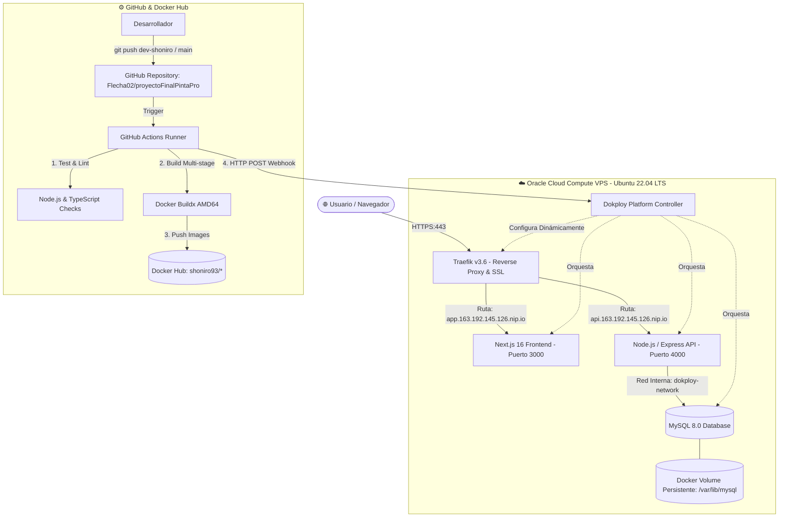

# 🚀 Documentación Técnica: Pipeline DevOps y Despliegue con Dokploy (PintaPro)

**Proyecto Final:** Pipeline DevOps con Aplicación Web  
**Curso:** Base de Datos 2 / Programación Web  
**Opción Seleccionada:** **Opción B - Despliegue con Docker y Dokploy en Cloud VPS**  
**Autor:** Diego Pineda (Shoniro93 / Flecha02)  
**Fecha:** Noviembre 2026  

---

## 📋 1. Resumen Ejecutivo y URLs de Producción

Se implementó un pipeline DevOps integral para el sistema de facturación e inventario **PintaPro**. La solución abarca desde la dockerización multi-etapa local, integración con registro público en Docker Hub, aprovisionamiento de infraestructura en Oracle Cloud Infrastructure (OCI), orquestación con Dokploy y Traefik con certificados SSL automáticos (Let's Encrypt), hasta la automatización continua mediante GitHub Actions con despliegues sin intervención manual vía Webhooks.

| Servicio | Entorno | URL / Host | Protocolo | Estado |
| :--- | :--- | :--- | :--- | :--- |
| **Frontend Web** | Producción | [https://app.163.192.145.126.nip.io](https://app.163.192.145.126.nip.io) | HTTPS (Let's Encrypt) | 🟢 Activo |
| **Backend REST API** | Producción | [https://api.163.192.145.126.nip.io](https://api.163.192.145.126.nip.io) | HTTPS (Let's Encrypt) | 🟢 Activo |
| **API Health Check** | Producción | [https://api.163.192.145.126.nip.io/api/health](https://api.163.192.145.126.nip.io/api/health) | HTTPS | 🟢 Activo |
| **Panel Dokploy** | Gestión DevOps | [http://163.192.145.126:3000](http://163.192.145.126:3000) | HTTP (Admin Auth) | 🟢 Activo |
| **Base de Datos** | Red Dokploy | `pintapro-db-fm2kgb:3306` | MySQL Wire | 🟢 Persistente |
| **Docker Hub Registry**| Público | [https://hub.docker.com/u/shoniro93](https://hub.docker.com/u/shoniro93) | OCI Registry | 🟢 Publicado |

---

## 🏛️ 2. Arquitectura del Sistema

La solución utiliza una arquitectura desacoplada en tres capas con aislamiento de red y proxy inverso automatizado.



---

## 🛠️ 3. Justificación de Tecnologías

| Componente | Tecnología | Justificación Técnica |
| :--- | :--- | :--- |
| **Cloud Provider** | Oracle Cloud Infrastructure (OCI) | Instancia Compute Always Free con IP pública estática y configuración de red virtual personalizable (VCN/Security Lists). |
| **Plataforma DevOps** | Dokploy (Docker Swarm Mode) | Plataforma de código abierto ligera que permite gestionar contenedores, volúmenes, dominios con SSL automático (Traefik) y webhooks sin la sobrecarga de un clúster Kubernetes completo. |
| **Frontend** | Next.js 16 (App Router) + Tailwind CSS v4 | Renderizado optimizado con `output: 'standalone'`, reduciendo la imagen de Node.js a solo lo estrictamente necesario para producción. |
| **Backend** | Express 5 / Node.js 20 | API REST modular, conexión optimizada mediante pool de conexiones con `mysql2/promise`. |
| **Base de Datos** | MySQL 8.0 con Volúmenes Docker | Compatibilidad relacional total con procedimientos almacenados (`sp_ValidarLogin`), transacciones ACID y persistencia desacoplada del ciclo de vida del contenedor. |
| **Proxy Inverso & SSL**| Traefik v3 | Detección automática de servicios y contenedores, renovación desatendida de certificados TLS con Let's Encrypt (desafío HTTP-01). |
| **Automatización CI/CD**| GitHub Actions | Integración nativa con el repositorio, ejecución en entornos limpios (`ubuntu-latest`) con soporte para caché y secretos encriptados. |

---

## 📦 4. Optimización de Contenedores (Dockerfiles Multi-stage)

Para garantizar un arranque rápido, alta seguridad y menor consumo de memoria en el VPS (1 OCPU / 1 GB RAM física), se diseñaron Dockerfiles multi-etapa (`multi-stage builds`):

### Frontend (`frontend/Dockerfile`)
1. **Etapa `deps`**: Instala dependencias con `npm ci` sobre `node:20-alpine` incluyendo `libc6-compat`.
2. **Etapa `builder`**: Compila Next.js en modo `standalone` e incrusta la variable `NEXT_PUBLIC_API_URL` en el bundle del cliente con Tailwind CSS PostCSS.
3. **Etapa `runner`**: Imagen final ultra reducida (295 MB) que ejecuta la aplicación bajo un usuario sin privilegios `nextjs:nodejs` (UID 1001) para máxima seguridad.

### Backend (`backend/Dockerfile`)
1. **Etapa `deps`**: Instala únicamente dependencias de producción (`npm ci --omit=dev`).
2. **Etapa `runner`**: Imagen base de 223 MB (53 MB comprimida) ejecutada como usuario no privilegiado `node` (UID 1000).

---

## 🔄 5. Pipeline de CI/CD (GitHub Actions)

El archivo de automatización [`.github/workflows/deploy.yml`](.github/workflows/deploy.yml) consta de tres fases secuenciales:

```
[ Push / PR a main o dev-shoniro ]
               │
               ▼
   [ 🔍 1. Validate & Lint Code ]
      ├── Sintaxis Backend (node --check)
      └── Validación TypeScript Frontend (npx tsc --noEmit)
               │
               ▼
   [ 🐳 2. Build & Push Docker Images ]
      ├── Autenticación segura en Docker Hub
      ├── Construcción con Buildx (amd64)
      └── Push de shoniro93/pintapro-backend y shoniro93/pintapro-frontend (latest + SHA)
               │
               ▼
   [ 🚀 3. Auto-Deploy to Dokploy ]
      ├── POST Webhook Backend: http://163.192.145.126:3000/api/deploy/...
      └── POST Webhook Frontend: http://163.192.145.126:3000/api/deploy/...
```

---

## 🔒 6. Verificación de Persistencia de Datos (Guía para Demostración)

Uno de los requisitos clave es comprobar que la base de datos persiste tras reiniciar o recrear los contenedores.

### Procedimiento de Prueba en Vivo:

1. **Ingreso al Sistema:**
   - URL: `https://app.163.192.145.126.nip.io`
   - Usuario: `pineda@pintapro.com` | Contraseña: `admin123` (Rol: Gerente)
   - Ir a la sección de **Productos** y observar los productos existentes (4 productos cargados inicialmente).

2. **Crear un nuevo registro de prueba:**
   - Crear un producto o cliente nuevo (ej. `PROD-TEST-DEVOPS`).
   - Verificar que aparece en la tabla.

3. **Reinicio forzado del contenedor de MySQL en Dokploy:**
   - Entrar al panel de Dokploy (`http://163.192.145.126:3000`).
   - Entrar al proyecto **PintaPro** ➔ **pintapro-db**.
   - Hacer clic en **Stop** y luego en **Start** (o ejecutar en el VPS `sudo docker restart <container_id>`).

4. **Verificación de Persistencia:**
   - Recargar la aplicación web `https://app.163.192.145.126.nip.io/productos`.
   - **Resultado Esperado:** El nuevo producto `PROD-TEST-DEVOPS` sigue intacto porque los datos residen en el volumen Docker persistente en el disco del host.

---

## 📊 7. Monitoreo y Métricas

En el panel de Dokploy se puede monitorear en tiempo real:
- **CPU y RAM por Contenedor:** Visualización gráfica en la pestaña **Monitoring** tanto de la base de datos MySQL como del frontend y backend.
- **Logs Centralizados:** En la pestaña **Logs** de cada servicio se visualizan en vivo las solicitudes HTTP entrantes, consultas SQL y logs de la consola de Node.js.
- **Estado de Salud de Swarm:** Verificación del estado de convergencia de los servicios y réplicas.

---

## 👥 8. Credenciales de Prueba para Calificación

| Usuario | Correo | Contraseña | Rol / Permisos |
| :--- | :--- | :--- | :--- |
| **Diego Pineda** | `pineda@pintapro.com` | `admin123` | **GERENTE** (Acceso a Reportes, Auditoría, Usuarios) |
| **Shoniro** | `shoniro@pintapro.com` | `admin123` | **DIGITADOR** (Compras, Inventario, Productos) |
| **Javier** | `javier@pintapro.com` | `admin123` | **CAJERO** (Ventas, Cotizaciones, Facturación) |

---
